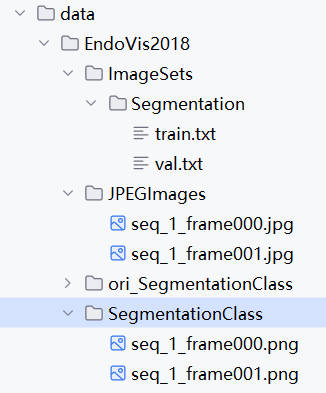
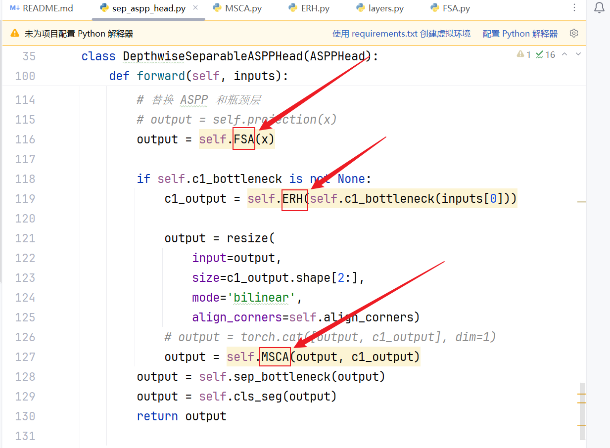

  <strong>ERH-Net: Edge Refinement and Homogenization with Frequency-Aware Multi-Scale Attention for Surgical Instrument Segmentation</strong>

  <u>Haikun Chen, Shuwan Pan, Qin Ye, Yuanda Lin, Jianqing Zhu, Lixin Zheng</u>

Huaqiao University

This repo is the official implementation of "<u>ERH-Net: Edge Refinement and Homogenization with Frequency-Aware Multi-Scale Attention for Surgical Instrument Segmentation</u>".

<strong>Overall Architecture</strong>

  

<strong>Getting Started</strong>

<strong>1. Environment</strong>

<strong>1.1 Clone this repo:</strong>

git clone https://github.com/HQU-ADL/ERH-Net.git

cd ERH-Net/

<strong>1.2 Create a new conda environment and install dependencies:</strong>

conda create -n ERH_Net python=3.10

conda activate ERH_Net

pip install -r requirements.txt

<strong>2. Data Preparation</strong>

<strong>2.1 Download the dataset:</strong>

(1) EndoVis2018:

https://endovissub2018-roboticscenesegmentation.grand-challenge.org/Downloads/

(2) EndoVis2017:

https://endovissub2017-roboticinstrumentsegmentation.grand-challenge.org/Downloads/

(3) m2caiSeg:

https://endovissub2018-roboticscenesegmentation.grand-challenge.org/Downloads/

<strong>2.2 Make sure the file structure is consistent with the following:</strong>

  

<strong>3. Training</strong>

<strong>3.1 Run the following script to train DEA-Net-CR from scratch:</strong>

bash tools/dist_train.sh configs/mobilenet_v2/mobilenet-v2-d8_ERH-Net_2xb8-30k_EndoVis2018-512x512.py 2

<strong>4. Details</strong>

<strong>4.1 decode_heads</strong>

mmseg/models/decode_heads/sep_aspp_head.py

  

<strong>4.2 ERH</strong>

mmseg/models/decode_heads/ERH.py

<strong>4.3 MSCA</strong>

mmseg/models/decode_heads/MSCA.py

<strong>4.4 FSA</strong>

mmseg/models/decode_heads/FSA.py

<strong>5. Contact</strong>

If you have any questions or suggestions about our paper and repo, please feel free to concat us via <a href="mailto:shuwanpan@hqu.edu.cn"><u>shuwanpan@hqu.edu.cn</u></a>
